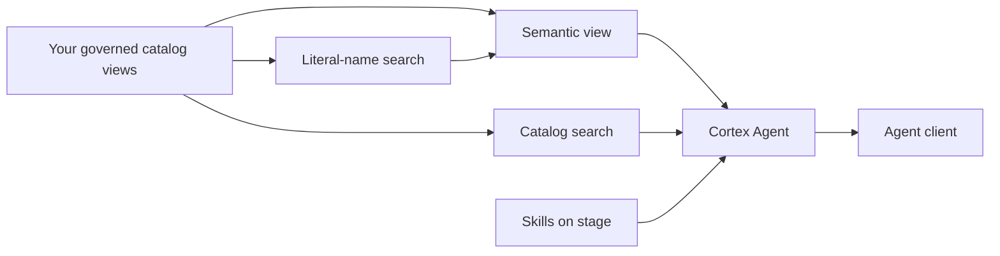

# Semantic View and Cortex Agent: Boilerplate Guide

These examples show how to put a semantic view, two Cortex Search services and a Cortex Agent over a governance catalog migrated from Collibra. They are templates to adapt, not a complete installation or a production-ready application.

All database identifiers, domain names, people, vendors and test expectations are illustrative. No customer extracts or credentials are included. The bronze and gold layers and their data are not distributed here.

## Files

- `sql/01_semantic_view.sql`: supporting views, literal-name search and `SV_DATA_CATALOG`, including 22 metrics and 15 example verified queries.
- `sql/02_search_and_agent.sql`: catalog search, a skills stage and `DATA_CATALOG_AGENT`.
- `skills/`: four workflow examples for glossary lookup, stewardship and access, vendor risk, and migration reconciliation.
- `tools/pressure_test.py`: an illustrative keyword-based smoke test for answers, tool routing and skill loading.

## Architecture



## Prerequisites

Supply your own database, warehouse and catalog views before running the SQL. The examples use `CATALOG_DEMO` as the database, `GOVERNED_DG` as the curated schema, `BRONZE_DG` as the source schema, and `COMPUTE_WH` as the warehouse.

The semantic view references these curated objects:

- `ASSET`, `ASSET_ATTRIBUTE`, `ASSET_RELATIONSHIP`, `ASSET_RESPONSIBILITY`, `DOMAIN`.
- `BUSINESS_TERM`, `TERM_COLUMN`.
- `APPLICATION`, `SYSTEM`, `VENDOR`, `VENDOR_APPLICATION`, `SYSTEM_APPLICATION`.
- `POLICY_STANDARD`, `RECON_ASSET_COUNTS`.

Relationship reconciliation also reads `BRONZE_DG.DG_ASSET_RELATION`. The SQL files define the supporting views `RECON_RELATIONSHIP_COUNTS`, `EFFECTIVE_RESPONSIBILITY`, `CATALOG_NAME_LITERALS` and `CATALOG_SEARCH_DOCS`; they do not define the prerequisite catalog objects above. Use each SQL expression to map the required columns to your schema.

Use a deployment role authorized to read the source objects, use the warehouse and create the relevant views, search services, stage and agent. Have your administrator review runtime access separately. Local commands require an authenticated Snowflake CLI connection; the optional test also requires a Cortex Code CLI that supports `cortex agents run`.

## Adapt before running

1. Replace `CATALOG_DEMO`, `GOVERNED_DG`, `BRONZE_DG` and `COMPUTE_WH` consistently, including fully qualified names inside the agent YAML.
2. Map source columns and relationships to your actual schema. Check primary-key uniqueness and join cardinality.
3. Replace sample values and verified-query literals, including `Analytics Mart`, `Contract Value` and `Surrender Charge`. Use `IS_ENUM` only for complete closed value lists.
4. Review ownership inheritance, access-request roles, migration lanes and agent skills against your governance process.
5. Validate each verified query against your adapted semantic view and check its results against direct queries over your catalog.
6. Replace every pressure-test fixture with questions and independently checked expected answers from your own environment.

The SQL uses `CREATE OR REPLACE`. Review existing objects and grants before deployment. Search services and agent requests can incur Snowflake charges. Do not run these examples against production without review.

## Run order

Run from the repository root because the second SQL file uploads the relative `skills/` paths. Replace `<connection>` with your local connection name; do not commit credentials or connection configuration.

```bash
snow sql -c <connection> -f sql/01_semantic_view.sql
snow sql -c <connection> -f sql/02_search_and_agent.sql
```

After adapting the fixtures, run the optional test:

```bash
python3 tools/pressure_test.py -c <connection> \
  --agent <DATABASE>.<SCHEMA>.DATA_CATALOG_AGENT
```

For one case, add `-k term_meaning`. Use `-j 1` to run cases sequentially. Results default to `pressure_test_results.json`; choose another path with `--output`.

## Semantic view design

- Descriptions explain table grain, field meaning and metric intent.
- Literal-name search helps resolve user wording to stored names.
- Named filters cover unapproved assets, physical assets, high-risk vendors and unlinked terms.
- `EFFECTIVE_RESPONSIBILITY` combines domain assignments with community-level assignments.
- Verified queries use logical dimension and fact names, such as `t.term_domain` and `t.linked_columns_fact`.
- Catalog metadata describes where data lives; it does not contain the business values inside catalogued tables.

## Agent design

- `catalog_analyst` handles counts, lists, filters and joins.
- `catalog_search` resolves loose names and retrieves descriptions.
- `data_to_chart` illustrates chart routing.
- Four staged skills hold the longer workflow instructions instead of putting everything in the standing prompt.
- Response instructions ask for exact definitions, query-backed totals and named accountable contacts.

The example exposes no write tool. Its instructions direct change requests to the responsible person. Prompt instructions are not an authorization boundary; apply appropriate privileges to the underlying objects.

## What the pressure test does and does not prove

The script invokes `cortex agents run`, reads the saved event trace, and checks expected keywords, tool names and skill names. Cases include a misspelling, a nonexistent term, an out-of-scope business-data request and a catalog-change request.

The bundled numbers are arbitrary fixtures, not results from a supplied dataset. No pass rate is claimed for this public version. Exact verified-query matches can bypass skill loading, so set the skill expectation for each case accordingly.

Keyword checks are a smoke test, not a semantic correctness evaluation or a security guarantee. Review complete traces and query results, and add tests that reflect your data and access requirements. Keep test outputs private because they may contain real catalog metadata or contact details.
